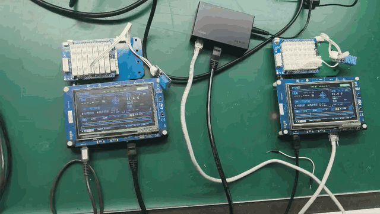
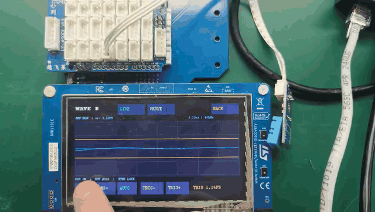
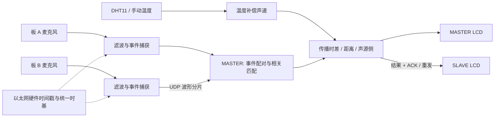

<div align="center">

# Acoustic Ranging

**基于 STM32F746G Discovery 的分布式声波测距与波形观测系统**

Two nodes. One time base. Acoustic time-difference measurement.


[演示](#演示) · [工作原理](#工作原理) · [快速开始](#快速开始) · [项目结构](#项目结构) · [验证与边界](#验证与边界)

</div>

两块开发板通过以太网建立统一时间基准，分别采集本板麦克风信号，交换带时间标记的声音片段，在板端完成匹配、传播时差估计、温度补偿及结果共享。触摸屏提供距离、声源侧、实时波形和事件波形，支持全屏观察及参数调节。

本项目面向嵌入式系统课程设计与实验研究，覆盖采集、通信、计时、信号处理和人机交互的完整链路。正常运行时，测距计算由开发板完成；电脑用于构建、烧录和诊断。

## 演示



*由实板录制视频截取的无声循环 GIF。演示用于展示运行与交互，不作为精度或同步误差的计量依据。*

<details>
<summary>查看全屏波形与触摸操作演示</summary>



</details>

## 功能概览

| 能力 | 实现方式 |
| --- | --- |
| 双节点协作 | 两板运行相同固件，自动分配链路本地地址、发现对端并选举 MASTER / SLAVE |
| 统一时间基准 | 以太网 MAC 硬件时间戳、时钟偏移与漂移估计、同步失锁检测 |
| 连续音频采集 | 48 kHz 双通道 DMA，预触发缓存和带时间标记的事件捕获 |
| 声学时差估计 | 波形相关、包络匹配、周期歧义检查及结果质量筛选 |
| 两种声源策略 | `CLAP` 拍手模式与 `PHONE` 标准音频模式，切换状态在双板间共享 |
| 抗干扰处理 | 250 Hz～8 kHz 带通滤波、背景噪声估计、自适应门限及重复触发抑制 |
| 环境温度补偿 | DHT11 温度读取、单传感器双板共享、自动 / 手动温度设置 |
| 波形交互 | `LIVE / EVENT` 切换、全屏波形、显示幅度缩放和触发门限调整 |
| 可靠结果传输 | 分片校验、事件标识、CRC32、结果确认与重发 |
| 硬件同步验证 | D3 / PB4 周期脉冲：每秒一次，高电平宽度 1 ms |

## 工作原理

### 测量的是声程差

系统比较**同一次声音到达两块板麦克风的时间差**，并结合声速计算声程差：

```text
Δt = tA − tB
Δr = c(T) × |Δt|
c(T) ≈ 331.3 + 0.606 × T  [m/s]
```

其中，`tA`、`tB` 位于统一时间域，`T` 为摄氏温度。当前声速公式以 `Core/Src/app_temperature.c` 为准。

当声源位于两麦克风连线的**外侧延长线**上时，声程差等于两麦克风间距；其他位置测得的是声源到两个麦克风的路径长度之差。

```text
声源 ● ──────── 麦克风 A ───────────── 麦克风 B
                         ← 实际麦克风间距 →
```

因此，该系统需要约定声源位置来测量板间距离。它不具备单凭两个麦克风确定任意声源绝对距离的能力。

### 数据处理链路



软件采用裸机主循环与中断协作：DMA 中断处理音频采样，定时器完成边沿计时和脉冲输出，主循环处理网络、匹配、状态维护与界面刷新。

### 网络通道

| UDP 端口 | 用途 |
| --- | --- |
| `50000` | 节点发现、主从角色与心跳 |
| `50001` | 时钟同步消息与时间戳交换 |
| `50002` | 声音片段、测量结果和 ACK |
| `50003` | 温度及共享操作设置 |

当前测量协议版本为 **6**，温度与共享设置协议版本为 **3**。升级时应同时烧录两板；历史文档可能记录旧版字段，以当前源码为准。

## 快速开始

### 硬件准备

| 硬件 | 数量 | 用途 |
| --- | --- | --- |
| STM32F746G Discovery | 2 | 音频采集、计算、以太网和触摸屏 |
| 以太网交换机及网线 | 1 台 / 2 根 | 双板网络连接 |
| ST-Link USB 连接线 | 2 | 固件烧录和调试 |
| 手机或扬声器 | 1 | 播放标准测试音 |
| DHT11 模块 | 1，可选 | 自动温度补偿；未接入时使用手动温度 |
| 双通道示波器 | 可选 | 检查实际同步脉冲边沿 |

两块板接到同一交换机。系统采用 AutoIP 链路本地地址，不依赖 DHCP 服务器。`A = MASTER`，`B = SLAVE`，实际角色由自动选举结果决定。

### 接线

| 功能 | 板上接口 | MCU 引脚 | 连接说明 |
| --- | --- | --- | --- |
| DHT11 信号 | `A0` | `PA0` | 模块 `S`，只需接其中一块板 |
| DHT11 电源 | `5V / GND` | — | 对应已验证的 LY-S0003 / DHT11 模块 `+ / −` |
| 同步脉冲输出 | **`D3`** | **`PB4`** | 两板均从此引脚输出，探头地夹接 GND |

当前同步脉冲已迁移到 **D3 / PB4**，旧文档中的 PA15 / D9 不再是现行输出接口。A0 在本项目中用于 DHT11 数字通信，不进行 ADC 温度换算。更换模块时需重新核对供电、信号电平和引脚定义。

### 构建与烧录

已使用 **IAR Embedded Workbench for Arm 9.1.5** 构建。HAL、BSP、CMSIS 和 LwIP 源文件随工程提供，IAR 工具链需自行安装。

```bash
git clone https://github.com/tims5f/Acoustic_Ranging.git
cd Acoustic_Ranging
```

1. 使用 IAR 打开 `EWARM/Project.eww` 工作区，选择 `LEDtest` 配置。
2. 执行 Rebuild，确认构建成功。
3. 通过 ST-Link 将**同一份固件**分别烧录到两块开发板。
4. 两板连接交换机并上电，等待对端在线和同步锁定。
5. 未接 DHT11 时，在屏幕上切换到手动温度并设置环境温度。

命令行构建示例（PowerShell）：

```powershell
& "<IAR安装目录>\common\bin\iarbuild.exe" EWARM/LEDtest.ewp -make LEDtest
```

构建产物位于 `EWARM/LEDtest/Exe/`。工程名沿用 `LEDtest`，不影响实际功能。部分历史调试配置含本机绝对路径，迁移电脑后需在 IAR 中核对调试与下载配置。

### 第一次测量

1. 测量并记录**两块板麦克风之间**的实际距离。
2. 将声源固定在 A / B 连线外侧，避免放在两板中间。
3. 在任一板上切到 `PHONE`，确认另一块板同步切换。
4. 循环播放 [pulses 测试音](tools/ranging_test_pulses.wav) 或 [chirp 测试音](tools/ranging_test_chirp.wav)，保持声源位置和音量固定。
5. 观察两板距离、声源侧与事件更新情况，再与实际距离比较。

拍手实验使用 `CLAP` 模式，建议各次拍手间隔至少 2 秒。`PHONE` 主要面向有明确起音的测试音，不保证任意音乐或持续纯音均能产生有效距离。

## 屏幕操作

| 控件 | 操作 |
| --- | --- |
| `CLAP / PHONE` | 选择拍手或手机标准音频处理策略，双板共享 |
| `LIVE / EVENT` | 连续实时波形 / 最近一次触发波形，双板共享 |
| `FULL` | 将本板波形展开为全屏 |
| `AMP− / AMP+` | 缩小 / 放大显示幅度，不改变麦克风输入增益 |
| `AUTO` | 恢复波形幅度自动缩放 |
| `TRIG− / TRIG+` | 调整本板声音触发门限 |
| `BACK` | 退出全屏，恢复主界面 |
| 温度 `− / +`、`AUTO / MAN` | 设置手动温度或启用传感器温度 |

全屏状态与显示幅度为本板设置。实时波形使用统一时间网格选取样本窗口，目标刷新周期为 50 ms；实际刷新可能受匹配计算和绘图耗时影响。全屏放大显示区域，不增加采样率或采样点数。

到达时刻 `TOA` 和传播时差变化量用于辅助观察测量过程。当前变化量定义为：

```text
J = abs(abs(Δt_current) − abs(Δt_previous))
```

`J` 比较相邻成功测量的绝对传播时差；首个有效结果没有可比较的前值。该值不等同于双板时钟同步误差。

## 项目结构

```text
Acoustic_Ranging/
├── Core/Inc/                 应用接口与外设声明
├── Core/Src/
│   ├── main.c                初始化、主循环与事件协调
│   ├── app_network.c         地址、节点发现、心跳及主从选举
│   ├── app_protocol.c        发现 / 心跳协议编解码
│   ├── app_clock.c           硬件时间戳与统一时间基准
│   ├── app_scope.c           D3 / PB4 硬件同步脉冲
│   ├── app_audio.c           DMA 采音、历史缓存与事件捕获
│   ├── app_audio_filter.c    滤波、背景估计及声音质量判断
│   ├── app_measure.c         波形传输、匹配、测距及结果共享
│   ├── app_dht11.c           DHT11 数字通信与校验
│   ├── app_temperature.c     温度补偿及共享设置
│   ├── app_touch.c           触摸采集
│   └── app_ui.c              主界面、全屏波形及触摸控件
├── Drivers/                  STM32 HAL、CMSIS 与板级 BSP
├── Middlewares/              中间件
├── LWIP/                     网络配置与接口
├── EWARM/                    IAR 工程与链接配置
├── tools/                    测试音生成、算法测试及调试辅助
└── docs/                     设计说明、协议记录及演示资源
```

## 验证与边界

以下为不同版本、特定条件下的历史实板记录，不代表全量程标定结果：

| 场景 | 已记录的结果 | 适用范围 |
| --- | --- | --- |
| PHONE，实际间距 280 mm | 一批 32 次结果为 275～278 mm，均值约 276.72 mm，标准差约 0.73 mm | 固定声源、固定设备和音量下的阶段实验 |
| 双板结果共享 | 一批 31 个共同事件，两板显示距离最大差值为 0 mm | 验证结果共享一致性，不等同于真值准确性 |
| CLAP，实际间距约 730 mm | 一批 6 个候选结果为 631～716 mm | 拍手重复性与误差仍需改进 |

详细条件和历史问题见 [音频模式记录](docs/audio_modes.md) 与 [抗干扰记录](docs/audio_noise_rejection.md)。

当前仍需关注：

- **反射与噪声**：房间混响、敲击、移动声源和不匹配的声音可能造成拒绝或异常结果。
- **拍手一致性**：已加入专用处理分支，仍需验证成功率、额外触发和多环境精度。
- **同步实测**：内部锁定状态和定时器完成记录不能替代示波器的上升沿时间差测量。
- **波形验收**：实时采样和全屏交互已实现，任意单音下的稳定静止、双板相位及刷新一致性仍需逐项实测。
- **适用距离**：尚未完成全距离范围和多设备的系统标定；不得将固定点实验外推为全量程精度保证。

### 软件测试

`tools/test_*.py` 覆盖滤波、匹配、温度共享、时差变化量、实时缓存读取及全屏交互等。部分测试通过宿主 GCC 编译实际 C 实现，需要 Python、MinGW-w64 GCC；部分另需 NumPy 或 Pillow。历史脚本可能包含本地编译器路径，运行前应按环境调整。

```powershell
python tools/test_live_waveform.py
python tools/test_waveform_fullscreen.py
```

软件测试用于验证代码行为；声学精度、触摸手感和物理同步需要实板实验。

## 进一步阅读

- [整体原理、模块职责与调试复盘](docs/分布式声波测距系统答辩说明.md)
- [测量通信协议](docs/measurement_protocol.md)
- [拍手 / 手机音频模式](docs/audio_modes.md)
- [滤波与防误触发](docs/audio_noise_rejection.md)
- [温度补偿与共享](docs/temperature_compensation.md)
- [到达时刻与时差变化量](docs/arrival_time_display.md)

历史文档保留了各阶段的实验过程，其中的引脚、版本号和界面位置可能早于当前实现；接线和构建以本 README 及源码为准。

## 参与改进

欢迎通过 Issue 提供可复现的问题。请尽量附上固件版本、板间麦克风距离、声源位置、工作模式、测试音、温度来源、两板同步状态及连续测量记录。

后续重点包括拍手鲁棒性、多环境标定、波形稳定性验证和测量性能优化。

## 致谢与许可

项目基于 STMicroelectronics STM32 HAL / BSP、Arm CMSIS 和 LwIP 构建，保留各组件原有版权与许可。项目开发过程中使用 AI 辅助代码实现、分析与文档整理，由项目成员完成需求确定、方案讨论、硬件集成和实板验证。

当前仓库未设置统一的项目许可证。第三方组件的许可请查看对应目录及源文件声明。
